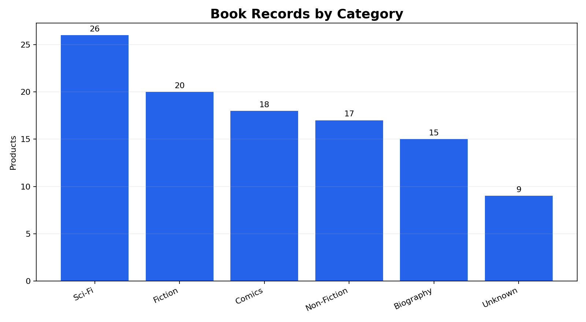
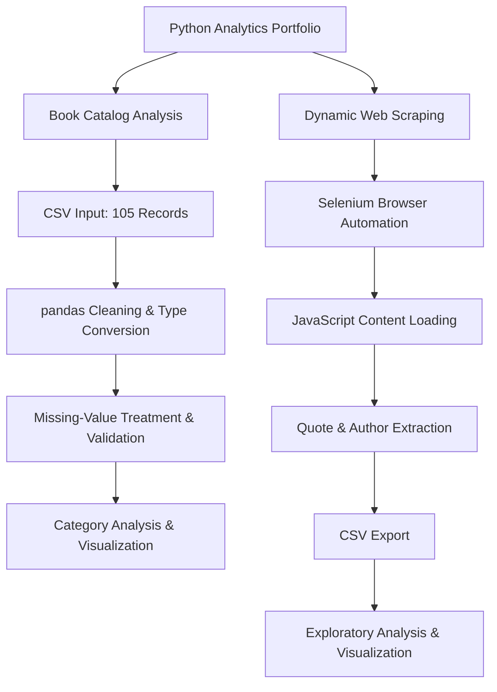
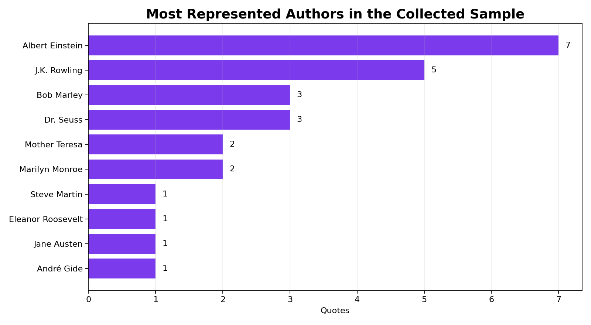

# Python Web Scraping and Data Analysis Portfolio

This portfolio demonstrates an end-to-end Python workflow: loading imperfect source data, cleaning and validating it with pandas, collecting dynamically loaded web content with Selenium, and translating the results into concise analytical findings.

**Academic context:** This portfolio originated in QMB 6938 Bootcamp Portfolio, a course in the University of Florida Warrington College of Business MS in Business Analytics program. I refined the course exercises into this public-facing case study to demonstrate Python, pandas, Selenium, data cleaning, visualization, and responsible web-data collection.

## Portfolio scope

### Book catalog data cleaning

The source file contains 105 book records with inconsistent category capitalization, missing values, a non-analytical column, and fields requiring type conversion.

The workflow:

- standardizes column names and categories;
- converts price, rating, and discount fields to numeric values;
- removes the unused `ExtraColumn` field;
- replaces missing prices and ratings with the corresponding mean;
- labels missing titles and categories;
- treats missing inventory values conservatively as unavailable; and
- validates that required analytical fields contain no remaining null values.

Selected results after cleaning:

- 105 book records
- 6 category labels, including an explicit `Unknown` group
- Average price: $18.53
- Average rating: 3.25 out of 5
- 38 products marked in stock
- Sci-Fi is the largest represented category with 26 products




## Technical Workflow

The portfolio contains two complementary Python workflows: structured data preparation and browser-based data collection.




### Dynamic web scraping

The Selenium workflow opens a JavaScript-rendered practice site, scrolls to load additional content, extracts quote text and author names, and exports the results to CSV.

The supplied output contains:

- 40 complete quote records
- 24 unique authors
- Average quote length of approximately 136 characters
- Albert Einstein as the most frequently represented author with 7 quotes



## Repository files

| File | Purpose |
| --- | --- |
| `python_web_scraping_analysis.ipynb` | Complete documented analysis and reproducible workflow |
| `scrape_quotes.py` | Standalone Selenium collection script |
| `week3_books.csv` | Original book catalog source data |
| `quotes.csv` | Scraped quote output used for analysis |
| `category_summary.png` and `top_authors.png` | Portfolio-ready analytical charts |
| `requirements.txt` | Python dependencies |


## Run Locally

### 1. Set up the Python environment

Python 3.10 or newer is recommended.

Clone the repository:

```bash
git clone https://github.com/yaysonvalencia/python-web-scraping-and-data-analysis-portfolio.git
cd python-web-scraping-and-data-analysis-portfolio
```

Create a virtual environment:

```bash
python -m venv .venv
```

Activate it:

**Windows**
```powershell
.venv\Scripts\activate
```

**macOS / Linux**
```bash
source .venv/bin/activate
```

Install dependencies:

```bash
python -m pip install -r requirements.txt
```

### 2. Run the analysis

Launch Jupyter:

```bash
jupyter notebook
```

Open `python_web_scraping_analysis.ipynb` and run all cells in order.

The notebook uses the included CSV files, so a fresh web scrape is not required.

### 3. Run the Selenium scraper (optional)

```bash
python scrape_quotes.py
```

The scraper requires a compatible browser and browser automation setup. Selenium may manage browser drivers automatically, depending on your environment.

### 4. Verify the results

After running the analysis, check that:

- The book dataset contains 105 records.
- Required analytical fields have no remaining null values.
- The cleaned dataset includes six category labels.
- The quote analysis reads the included `quotes.csv` file.
- Both analytical charts render successfully.

Results from a fresh scrape may differ if the practice website changes.


## Responsible-use note

The scraping example uses `quotes.toscrape.com`, a public website designed for scraping practice. A production workflow should review the target site's terms, robots directives, request-rate expectations, privacy implications, and applicable laws before collecting content. The script uses limited scrolling and does not attempt to bypass access controls.

## Limitations

- The book dataset is synthetic and supports method demonstration rather than market conclusions.
- Mean imputation preserves all records but can reduce observed variability.
- Missing inventory values are treated as unavailable, which may understate stock availability.
- The quote sample reflects only content loaded during three scroll cycles and is not representative of authors or literature generally.
- Dynamic websites can change their HTML structure, which may require selector updates.

## Skills demonstrated

Python, pandas, data cleaning, exploratory data analysis, Selenium, dynamic web scraping, CSV export, validation, and analytical communication.

## Author

Yayson Valencia  
MS in Business Analytics candidate, University of Florida
